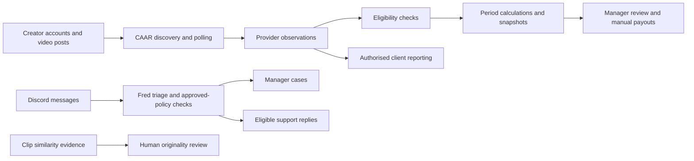
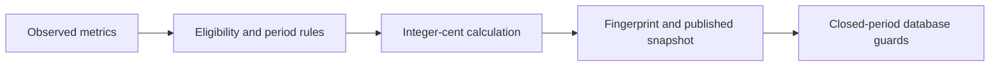
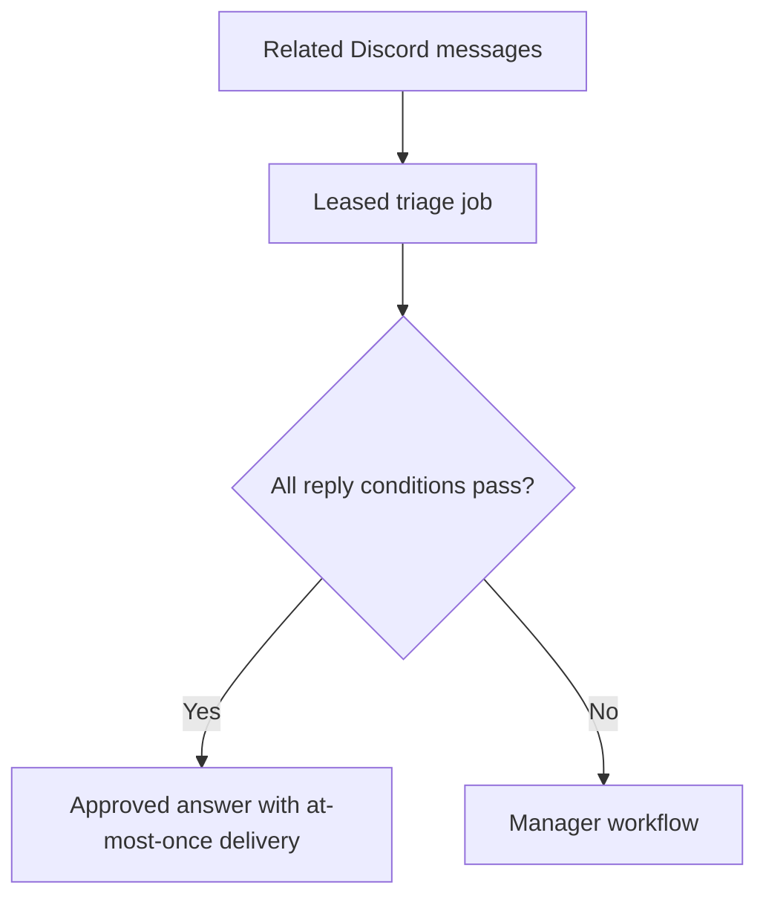
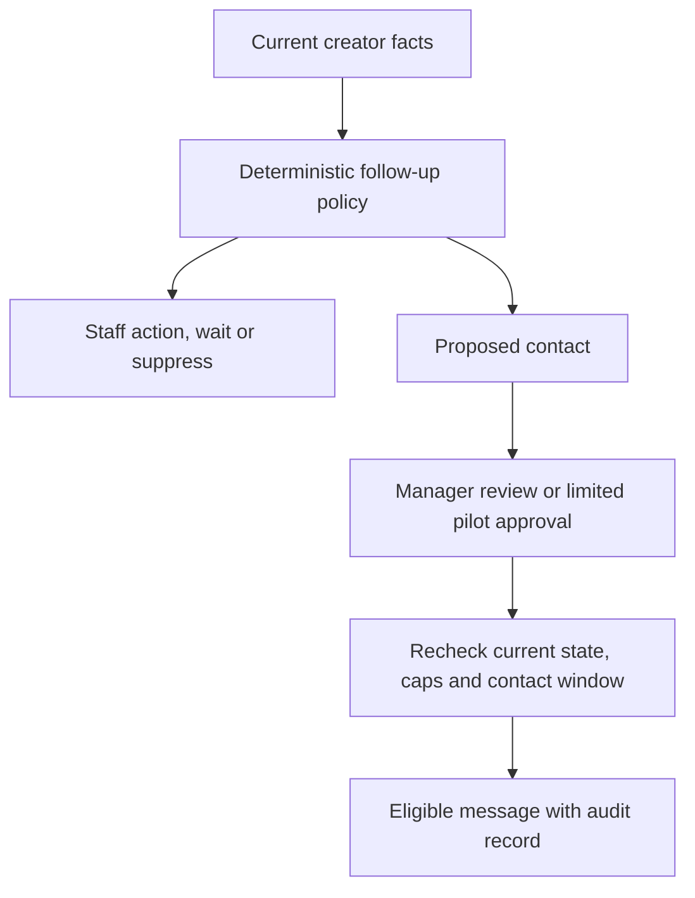

# Creator infrastructure

Engineering notes from the systems I build and operate as co-founder and technical lead at [Clipping Cartel](https://clippingcartel.com).

**Author:** [Tyler Andrew Natorca](https://www.linkedin.com/in/tyler-andrew-natorca/) / [@vIlkAm](https://github.com/vIlkAm)

The focus is the decisions connecting tracking, earnings, reporting and local AI. These are public architecture write-ups; the production implementations and business data are private. Diagrams are simplified. Status and measurements are dated **2 October 2026**.

## System map

## 1. Tracking evidence and payout periods

**Production.** The platform tracks more than 27,000 videos across TikTok, Instagram and YouTube. CAAR replaced a third-party tracker; the previous sync was retired in August 2026.

### Coordinating work across workers

Polling workers share a database-coordinated provider request slot and respect provider retry instructions. This keeps parallel workers within one request budget. Polling frequency follows a tiered policy, including a configurable grace window after a period ends.

Discovery verifies upload dates before a post can become payable. It bounds direct lookups, stops discovering when a campaign budget is exhausted, and chunks account queries to stay within request-URI limits.

### Keeping financial meaning explicit

Observed views, eligible views and money owed are separate concepts. Calculations use integer cents and publish snapshots with calculation fingerprints. Database triggers guard closed periods and their cached calculations.

The test surface includes polling-policy and rate-limit helper tests, upload-date checks, payout eligibility SQL invariants, period-boundary invariants and snapshot publication tests. The useful question is whether later observations can silently rewrite a closed financial period.

Payout execution remains a manual company-funded process. This write-up does not imply automatic bank or crypto payments.

## 2. Fred: the conditions before an AI answers

**Production triage, case boards and compatibility work items; limited auto-answers.** Fred coalesces message bursts into leased AI jobs, surfaces cases and updates a manager board in place.

Automatic support replies require an owner-approved policy answer, a confidence gate, a verified ticket owner, active membership and at-most-once delivery. Cases outside those conditions stay with the manager workflow.

An offline evaluation harness scores labelled gold sets against recommended promotion gates for unsafe answers, manager-action recall and safe-answer precision. A small synthetic calibration answered 26 of 34 questions with no incorrect answers among those 26. That describes those examples, not a guarantee for every future ticket. The limited policy went live on 2 October 2026; as of this review, no automatic answer had yet been delivered in production.

The memory service also applies personal-data scrubbing before storage. Monitoring and access controls are part of operating the feature, alongside model selection.

### The internal CRM and manager workflow

Managers work from one board per staff channel, split into payment, technical and general lanes. Counts come from the authoritative case state. Cases can be claimed, wait for a creator, resolve and reopen when a new message arrives. Urgent issues escalate immediately; aging high-priority work has a reminder backstop. Reply drafts are for a manager to copy, edit and send. A manager-created work item is never overwritten by the classifier.

The follow-up engine checks identity and opt-out, payment state, company-owned blockers, promises to return, onboarding, activity, cadence and the contact window. It can propose staff work, wait, suppress contact or propose a message. Managers retain Send / Edit / Snooze / Dismiss / Never controls.

The autonomous follow-up pilot is live for one deal, capped at three messages per 24 hours. It requires two independent model reviews to agree and rechecks current state before delivery. As of 2 October, eight messages had been delivered: three autonomous and five approved by an operator.

In 317 recorded follow-up decisions, the most common reason (123) was that the company itself was the blocker. All 123 proposed staff work, not a hold, suppression or message: when the company is the blocker, the work goes to staff instead of nudging the creator. These are workflow decisions, not a count of people or sent messages.

The staff copilot extracts to-dos, unanswered questions, decisions and issues into manager commands. Situation notes use fixed queries for every figure, with generated wording checked against those facts. Scanning and commands are live; the daily standup is paused. Situation notes are stored, with Discord posting off. A separate situation analyst remains in shadow.

The onsite review ran 46 workflow test modules from live bot revision `0158c0c` inside its production image, in network-isolated containers: **680 tests passed**. No time-savings baseline exists, so this write-up claims concrete routing and review behavior rather than a productivity percentage.

## 3. A benchmark that remembered its own answers

**Measured experiment and rollback; bounded caller concurrency shipped.** I tested n-gram speculative decoding for our CPU-hosted local model. The first harness repeated each prompt three times and took the median.

Later repetitions could draft from earlier output stored in the n-gram table. This inflated acceptance and produced roughly 1.8× apparent gains on repeated workloads. At temperature zero, outputs stayed identical, so correctness checks passed while the performance comparison remained misleading.

With 14 distinct realistic prompts, the cold subset measured about 1.01× and the warm subset about 0.96×. The speculation settings were rolled back the same day.

### The improvement that stayed

The application was barely using the inference server's available slots. A separate test compared sequential and four-way concurrent processing of 12 distinct prompts, in both run orders. The more conservative run improved **batch throughput by 1.88×**.

The caller now uses bounded concurrency with three jobs by default, retaining one slot for interactive work. Seven targeted tests cover that parallel-work path. This is a throughput result from that benchmark, not a speculative-decoding gain or a promised per-request latency improvement.

The lesson: use distinct realistic inputs, test both run orders, and inspect production counters. Healthy output alone does not validate a performance benchmark.

## 4. Clip similarity as evidence for human review

**Production similarity worker.** The review pipeline combines exact file matches, perceptual video hashes, frame embeddings and audio timing. Candidate pairs must meet several evidence conditions, and accounts owned by the same verified person are excluded.

A human reviews the resulting evidence. The worker does not automatically accuse a creator or impose enforcement. Scoring tests, vision tests and database evidence invariants cover the review path.

### A separate source-matching experiment

For locating a short clip's original long-form moment, visual similarity had a different failure mode: a creator's studio looked similar across unrelated videos.

An internal research tool instead transcribes the clip with Whisper and searches four-word sequences in source captions. In one catalogue, it matched 89% of clips with speech when the broader caption history was available. This depends on speech and caption coverage; it is separate from the production originality-review system.

## Other operational work

| Capability | Behavior and evidence |
|---|---|
| **Client reporting** | Server-side response filtering and separation of gross views from the payout basis. Reporting code is merged; this review did not independently verify the served frontend bundle. |
| **Late-observation reconstruction** | A production runner allocates views across days before the first observation using neighbouring view curves and integer-preserving rounding. A September backfill allocated roughly 61M views across 1,909 day entries without changing payouts. These allocations are model estimates. |
| **Recovery drills** | A network-isolated restore from an off-site backup matched roughly 1.3M rows on 1 October 2026. |
| **Monitoring** | An operations bot reads signed aggregates through a restricted bridge, with no Docker socket or database credentials. |
| **Release guards** | Deployment checks committed and pushed code, verifies tests, and preserves a rollback image. |

## Research and release status

- **TRIBE:** research on 1,486 clips; +0.009 Spearman improvement against a pre-registered +0.020 threshold, reported as no-go.
- **clip-moments:** internal source-matching research.
- **[coding-memory](https://github.com/vIlkAm/coding-memory):** released local Python CLI for Markdown coding-session notes, search and corrections. [v0.1.0](https://github.com/vIlkAm/coding-memory/releases/tag/v0.1.0) includes installable packages and checksums under MIT; 194 tests pass on Python 3.12–3.14.
- **agent-voice-bridge:** local voice-decision bridge; 62 tests reported passing in the onsite review. Public release preparation remains in progress, including provider round-trip verification.
- The next dashboard, the successor payout workflow, disabled identity-check requirements and the crypto-payment pilot are not presented here as released capabilities.

## Evidence and authorship

These notes were prepared from an onsite review of canonical web main `ec911f80`, bot `44dd915`, supporting source/tests, current operational documentation and live-state checks. The manager workflow review was refreshed against live bot `0158c0c` on 2 October 2026. Internal source references are retained in the author's private evidence notes. The public repo contains no individual live records, client names, internal rates, credentials, infrastructure addresses or production source exports.

I use AI-assisted development and own the architecture, evaluation and production operation. Benchmarks and research results include their scope and limitations.

[Business](https://clippingcartel.com) · [LinkedIn](https://www.linkedin.com/in/tyler-andrew-natorca/) · [GitHub](https://github.com/vIlkAm)
